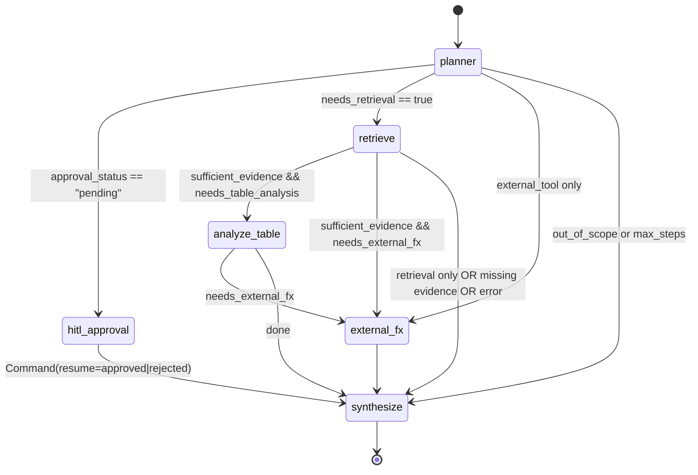

# Enterprise Agent Orchestration Layer (Project 2)

A stateful, observable, fault-tolerant **LangGraph** agent orchestration service built on top of Project 1 (`enterprise-rag-engine`) strictly through its public REST API.

Designed to operate at **$0 cost** on constrained CPU hardware using free-tier OpenAI-compatible LLM providers (Groq, Google Gemini, or local Ollama), deterministic Python table analytics, resilient external REST tooling, and SQLite-backed Human-in-the-Loop (HITL) persistence.

---

## Table of Contents

1. [Capabilities](#capabilities)
2. [Architecture & State Machine](#architecture--state-machine)
3. [Technology Choices & Trade-Offs](#technology-choices--trade-offs)
4. [Repository Structure](#repository-structure)
5. [Quick Start](#quick-start)
6. [Configuration Reference](#configuration-reference)
7. [API Reference & Examples](#api-reference--examples)
8. [Fault Tolerance & Resilience](#fault-tolerance--resilience)
9. [Testing & Linting](#testing--linting)
10. [Containerized Deployment](#containerized-deployment)
11. [Known Limitations & Scaling Path](#known-limitations--scaling-path)

---

## Capabilities

- **Query Understanding & Intent Classification:** Rewrites follow-up queries using conversation history (`thread_id`) and routes across five distinct task classes:
  - `retrieval` — Grounded document lookup via Project 1
  - `multi_step_reasoning` — Document retrieval + deterministic table analysis + live external FX conversion
  - `external_tool` — Live external API execution without unnecessary document searches
  - `sensitive_action` — Governed actions requiring Human-in-the-Loop (HITL) approval
  - `out_of_scope` — Unsupported requests handled without wasted retrieval calls
- **Domain-Agnostic Table & Math Analyzer:** Parses any retrieved Markdown table (insurance schedules, regulatory penalty tables, financial ledgers, technical SLAs), deduplicates overlapping rows, filters by date or query keywords, and computes exact per-column statistics (`count`, `sum`, `min`, `max`, `first`, `last`).
- **Live External API With Fallback:** Integrates with the zero-key Frankfurter FX API (`api.frankfurter.app`) using timeouts, retries, and an explicit approximate static fallback when unreachable.
- **Human-in-the-Loop (HITL) Pause & Resume:** Suspends sensitive actions via LangGraph `interrupt()`, persists exact graph state to SQLite (`SqliteSaver`), and resumes cleanly via `POST /api/v1/agent/approve`.
- **Zero-Hallucination Refusal:** When Project 1 returns `sufficient_evidence: false` or is unreachable, the synthesizer refuses deterministically without invoking the LLM.
- **Observability & Cost Tracking:** Propagates `X-Request-ID` across Project 2 -> Project 1 HTTP calls, records per-node latency traces, tracks `prompt_tokens` / `completion_tokens`, and computes configurable execution cost.

---

## Architecture & State Machine

Project 2 communicates with Project 1 **exclusively over HTTP** (`RagEngineClient`) with zero shared internal code or shared database tables.



---

## Technology Choices & Trade-Offs

| Component | Selected Stack | Why Chosen (Trade-Offs) |
| :--- | :--- | :--- |
| **Orchestration** | **LangGraph** (`StateGraph`) | Explicit state transitions, `max_steps` loop protection, conditional routing, and native `interrupt()` + checkpointer pause/resume. |
| **LLM Integration** | `langchain-openai` (`ChatOpenAI` adapter) | Speaks standard OpenAI Chat Completions protocol—switches seamlessly via `.env` between **Groq free tier**, **Google Gemini free tier**, or **local Ollama** with $0 cost and 0 MB local LLM RAM. |
| **State Persistence** | `SqliteSaver` (`langgraph-checkpoint-sqlite`) | Lightweight local persistence for conversation threads and pending HITL approvals without running extra database containers or coupling to Project 1's Postgres instance. |
| **Table Math** | Deterministic Python parser (`table_analyzer.py`) | Small LLMs frequently miscount Markdown table rows or miscalculate decimals; deterministic Python guarantees exact counts and sums at 0 token cost. |
| **HTTP Client** | `httpx` (`RagEngineClient`, `FxClient`) | Explicit connect/read timeouts, exponential backoff retries on transient `502/503/504`/network errors, and `MockTransport` support for fast deterministic tests. |

---

## Repository Structure

```text
enterprise-agent-orchestrator/
├── .env.example                      # Template environment variables
├── .dockerignore
├── .gitignore
├── Dockerfile                        # Non-root Python 3.11-slim container build
├── docker-compose.yml                # Memory-capped (512M) container runtime
├── pyproject.toml                    # Dependencies, pytest, and ruff config
├── docs/
│   └── architecture.md               # State machine diagram & ADRs
├── src/agent_orchestrator/
│   ├── main.py                       # FastAPI app, lifespan, X-Request-ID middleware
│   ├── config.py                     # Pydantic BaseSettings
│   ├── logging.py                    # Structured JSON logger + ContextVar request_id
│   ├── exceptions.py                 # Domain exceptions (404, 409, 503)
│   ├── service.py                    # AgentOrchestrationService (run, approve, threads)
│   ├── api/
│   │   ├── health.py                 # /health/live, /health/ready
│   │   └── agent.py                  # /api/v1/agent/run, /approve, /threads/{id}
│   ├── clients/
│   │   └── rag_client.py             # Resilient Project 1 HTTP client
│   ├── llm/
│   │   └── provider.py               # Provider-agnostic ChatOpenAI factory
│   ├── tools/
│   │   ├── table_analyzer.py         # Generic Markdown table & numeric stats tool
│   │   └── fx_client.py              # Live Frankfurter FX client + static fallback
│   ├── graph/
│   │   ├── state.py                  # AgentState TypedDict & token helpers
│   │   ├── routing.py                # Conditional edges & max_steps loop guard
│   │   ├── workflow.py               # Compiled StateGraph + SqliteSaver
│   │   └── nodes/
│   │       ├── planner.py            # Query understanding, intent & plan node
│   │       ├── tools_nodes.py        # Retrieve, analyze_table, external_fx nodes
│   │       ├── hitl.py               # LangGraph interrupt() approval node
│   │       └── synthesizer.py        # Grounded answer & deterministic refusal node
│   └── schemas/
│       ├── common.py                 # Health & standardized ErrorResponse schemas
│       └── agent.py                  # Planner & Agent API Pydantic contracts
└── tests/
    ├── unit/                         # Client retries, planner, table math, routing, HITL
    └── integration/                  # FastAPI TestClient HITL & outage tests
```

---

## Quick Start

### Prerequisites
- Python **3.10+** (3.11+ recommended)
- **Project 1 (`enterprise-rag-engine`)** running on `http://127.0.0.1:8000`
- A free API key (no credit card required) from **Groq** (`console.groq.com`) or **Google AI Studio** (`aistudio.google.com`), or local **Ollama**

### 1. Configure Environment
```powershell
Copy-Item .env.example .env
```
Edit `.env` to match your chosen provider (example for Groq):
```dotenv
RAG_ENGINE_BASE_URL=http://127.0.0.1:8000
LLM_PROVIDER_NAME=groq
LLM_BASE_URL=https://api.groq.com/openai/v1
LLM_API_KEY=gsk_your_free_key_here
LLM_MODEL=llama-3.1-8b-instant
```

### 2. Install Dependencies
```powershell
python -m venv .venv
.\.venv\Scripts\Activate.ps1
python -m pip install --upgrade pip
pip install -e ".[dev]"
```

### 3. Run the Service (Port `8001`)
```powershell
uvicorn agent_orchestrator.main:app --reload --port 8001
```
Open interactive Swagger UI at **http://127.0.0.1:8001/docs**.

---

## Configuration Reference

| Variable | Default | Description |
| :--- | :--- | :--- |
| `APP_NAME` | `enterprise-agent-orchestrator` | Service name reported by health endpoints |
| `LOG_LEVEL` | `INFO` | Logging verbosity |
| `RAG_ENGINE_BASE_URL` | `http://localhost:8000` | Project 1 base URL (prefer `127.0.0.1` on Windows) |
| `RAG_ENGINE_TIMEOUT_SECONDS` | `10.0` | HTTP read/connect timeout per Project 1 attempt |
| `RAG_ENGINE_MAX_RETRIES` | `2` | Retries on `502/503/504` or network timeout |
| `LLM_PROVIDER_NAME` | `groq` | Provider label recorded in `cost_summary` |
| `LLM_BASE_URL` | `https://api.groq.com/openai/v1` | OpenAI-compatible base URL (Groq / Gemini / Ollama) |
| `LLM_API_KEY` | `""` | Provider API key (`ollama` if running locally) |
| `LLM_MODEL` | `llama-3.1-8b-instant` | Model identifier |
| `LLM_TEMPERATURE` | `0.0` | Deterministic planning/synthesis temperature |
| `LLM_TIMEOUT_SECONDS` | `20.0` | LLM request timeout |
| `FX_API_BASE_URL` | `https://api.frankfurter.app` | Free no-key FX conversion endpoint |
| `FX_TIMEOUT_SECONDS` | `5.0` | FX API timeout before triggering static fallback |
| `DEFAULT_CURRENCY` | `INR` | Fallback base currency if not inferred from text/query |
| `AGENT_MAX_STEPS` | `6` | Hard step ceiling preventing infinite agent loops |
| `CHECKPOINT_DB_PATH` | `agent_checkpoints.db` | Local SQLite file for LangGraph checkpoints |
| `LLM_COST_PER_1M_INPUT_TOKENS` | `0.0` | Input token rate (USD per 1M tokens) |
| `LLM_COST_PER_1M_OUTPUT_TOKENS` | `0.0` | Output token rate (USD per 1M tokens) |

---

## API Reference & Examples

### 1. Health Probes
- `GET /health/live` — Process liveness check.
- `GET /health/ready` — Verifies Project 1 `/health/ready` reachability and LLM API key presence (`503` if degraded).

### 2. Run an Agent Turn (`POST /api/v1/agent/run`)
```powershell
curl.exe -X POST "http://127.0.0.1:8001/api/v1/agent/run" `
  -H "Content-Type: application/json" `
  -d "{\"query\": \"What is the Platinum annual limit in EUR?\"}"
```

**Completed Multi-Step Response Example:**
```json
{
  "thread_id": "thr_a1b2c3d4e5f6",
  "status": "completed",
  "intent": "multi_step_reasoning",
  "final_answer": "The Platinum annual limit is $250,000 (~€231,480.00) [1].",
  "citations": [
    {
      "citation_id": "[1]",
      "document_name": "policy.pdf",
      "page_number": 2
    }
  ],
  "tool_outputs": [
    {
      "tool": "table_analyzer",
      "matched_row_count": 1,
      "primary_numeric_value": 250000.0
    },
    {
      "tool": "external_fx",
      "amount": 250000.0,
      "base_currency": "USD",
      "target_currency": "EUR",
      "converted_amount": 231480.0,
      "is_fallback": false
    }
  ],
  "trace": [
    {"node": "planner", "status": "ok", "duration_ms": 420.1, "detail": "intent=multi_step_reasoning"},
    {"node": "retrieve", "status": "ok", "duration_ms": 380.4, "detail": "sufficient_evidence=True, chunks=1"},
    {"node": "analyze_table", "status": "ok", "duration_ms": 1.2, "detail": "matched_rows=1"},
    {"node": "external_fx", "status": "ok", "duration_ms": 210.5, "detail": "250000.0 USD -> 231480.0 EUR"},
    {"node": "synthesize", "status": "ok", "duration_ms": 390.0, "detail": "Synthesized grounded response"}
  ],
  "total_duration_ms": 1402.2,
  "cost_summary": {
    "provider": "groq",
    "model": "llama-3.1-8b-instant",
    "billing_tier": "free_tier",
    "prompt_tokens": 950,
    "completion_tokens": 180,
    "total_tokens": 1130,
    "estimated_cost_usd": 0.0
  }
}
```

### 3. Human-in-the-Loop Approval (`POST /api/v1/agent/approve`)
When a sensitive action is requested (e.g., `"Send a compliance alert report to the external regulator"`), `/run` returns `"status": "awaiting_approval"` with an `approval_request` payload. Resume it via:

```powershell
curl.exe -X POST "http://127.0.0.1:8001/api/v1/agent/approve" `
  -H "Content-Type: application/json" `
  -d "{\"thread_id\": \"thr_a1b2c3d4e5f6\", \"approved\": true, \"reviewer\": \"lead_fde\", \"note\": \"Verified\"}"
```
- Returns `404 THREAD_NOT_FOUND` for unknown threads and `409 APPROVAL_NOT_PENDING` if already resolved.

### 4. Inspect Conversation Thread (`GET /api/v1/agent/threads/{thread_id}`)
Returns persisted conversation messages (`human` / `ai`) and current `approval_status` for multi-turn UI rendering.

---

## Fault Tolerance & Resilience

| Failure Scenario | Built-In Mitigation |
| :--- | :--- |
| **Planner LLM rate-limit or bad JSON** | `_deterministic_fallback_plan()` checks sensitive keywords and falls back safely to grounded retrieval. |
| **Project 1 transient `502/503/504` or timeout** | `RagEngineClient` retries with exponential backoff (`0.2s`, `0.4s`); non-retryable `4xx` fails immediately. |
| **Project 1 completely down** | `retrieve_evidence_node` catches `UpstreamServiceError` and `synthesizer` returns `"status": "failed"` cleanly (no `500` crash). |
| **Missing document evidence** | `route_after_retrieve` short-circuits straight to `synthesizer`, returning `"status": "refused"` without calling the LLM. |
| **Live FX API unreachable** | `FxClient` falls back to approximate static rates, sets `is_fallback: true`, and instructs the synthesizer to disclose the warning. |
| **Infinite agent loop** | Every conditional edge enforces `step_count >= agent_max_steps` before routing. |

---

## Testing & Linting

Run all unit and API integration tests (uses `httpx.MockTransport` and stub LLMs—no external API keys or running Postgres required):

```powershell
.\.venv\Scripts\python.exe -m pytest -v
.\.venv\Scripts\python.exe -m ruff check src tests
```

---

## Containerized Deployment

Build and run Project 2 in Docker (`512 MB` memory cap) while connecting to Project 1 on host port `8000`:

```powershell
docker compose up --build -d
```

SQLite checkpoints persist inside the `agent_data` Docker volume (`/app/data/agent_checkpoints.db`).

---

## Known Limitations & Scaling Path

| Area | Current Limitation | Production Scaling Path |
| :--- | :--- | :--- |
| **Checkpointer Concurrency** | `SqliteSaver` is single-node local storage. | Swap to `PostgresSaver` (`langgraph-checkpoint-postgres`) for multi-replica horizontal scaling (Project 4). |
| **Table Math Scope** | `table_analyzer` inspects tables within retrieved top-K chunks (`top_k=5`). | Add a dedicated SQL/DuckDB table store if cross-document aggregations over 50+ pages are needed. |
| **Sensitive Action Execution** | `hitl_approval_node` records a governed audit execution payload rather than executing destructive live webhooks/deletes. | Wire approved payloads to signed downstream action adapters behind RBAC (Project 6). |
| **Evaluation & Tracing** | Per-request `trace` and `token_usage` are returned in JSON, without long-term dashboards or automated accuracy scoring. | Add OpenTelemetry tracing, benchmark datasets, and automated regression gates in **Project 3**. |
